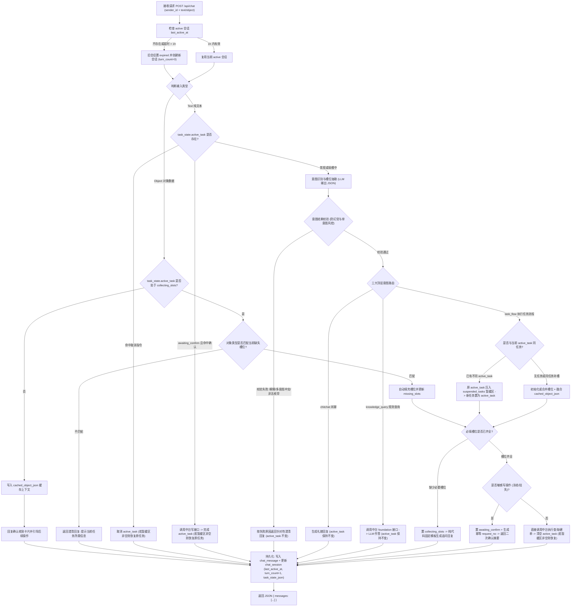

# 智能银行客服后端技术规格说明书（SPEC）

> 本文档定义银行智能客服后端（`chat_app/`）在 MVP 阶段的业务边界、技术选型、对话与编排机制、数据模型及上下游接口契约，作为后续拆解 `PLAN.md` 与编码实现的唯一事实来源。

---

## 1. 核心功能与边界

### 1.1 系统定位
智能客服后端作为 BFF / 对话编排服务，运行在 `127.0.0.1:8001`：
- **对上游（`web/`）**：提供非流式同步对话与历史记录接口，严格对齐现有 Vue 3 前端（不修改前端代码）。
- **对下游（`app/`）**：按业务意图通过 HTTP 调用银行业务中台（`127.0.0.1:8000/api/v1`），复用中台的客户级鉴权、账户账务与工单能力。

### 1.2 MVP 核心场景（5 大场景）

| 编号 | 场景 | 典型用户输入 / 触发方式 | 核心行为 |
| --- | --- | --- | --- |
| S1 | **账户与余额查询** | “查询账户余额”、点击快捷按钮、发送账户卡片后询问余额/状态 | 查询客户名下账户列表或指定账户详情（状态、余额、冻结金额、币种、产品名），支持自然语言汇总回复 |
| S2 | **交易明细与单笔交易查询** | “查询近期交易明细”、指定账户/交易类型/时间查明细、发送交易卡片询问详情 | 查询指定账户（若未指定则结合上下文焦点或客户默认主账户）的近期交易明细，或查单笔交易状态与对账结果 |
| S3 | **申请账户冻结 / 挂失** | “申请账户冻结/挂失”、“把 ACC0000000001 冻结/挂失” | **强确定性多轮流程**：补全 `account_no`、`target_status`（`frozen`/`lost`）、`reason` → 输出摘要要求用户明确二次确认 → 确认后带幂等 `request_no` 调用中台变更账户状态 |
| S4 | **银行业务规则问答（FAQ）** | “转账限额和手续费怎么算”、开户门槛/账户产品、支持币种/渠道/网点电话等 | 根据意图识别出的咨询主题，实时调用中台 `foundation` 接口查询限额、费率、产品、渠道、币种或网点信息，再由 LLM 基于真实接口数据生成准确中文解答 |
| S5 | **转人工客服（创建工单）** | “转人工客服”、“帮我联系人工处理某某问题” | 收集或归纳诉求后，调用中台 `POST /api/v1/support/tickets` 创建客服工单并返回工单号 `ticket_no`；**建单后不锁死会话**，用户仍可继续与智能客服对话 |

**补充交互能力**：
- **对象卡片上下文聚焦**：接收前端右侧栏发送的 `account` / `transaction` 卡片，落库并更新当前会话焦点对象，客服确认收到并引导可执行操作（查余额、查明细、冻结/挂失等）。
- **轻量通用闲聊**：允许问候、感谢、一般性礼貌寒暄，并在合适时自然引导回银行业务。
- **多轮流程中断**：处于填槽或待二次确认状态时，用户输入“取消 / 不用办了 / 算了”等指令可立即清空待办状态并退出流程。

### 1.3 MVP 明确不做（Out of Scope）
- **中台其他业务域**：理财（`wealth`）、信贷/授信（`loans`）、还款与逾期（`repayments`）、风控/反洗钱（`risk`）、催收（`collections`）、对账调账（`reconciliation`）等接口一律不接入。
- **高风险资金动账**：不支持开户、绑卡、主动转账/充值/提现等资金交易写操作。
- **SSE 流式输出**：不改造现有前端，MVP 不提供 SSE/WebSocket 流式推送。
- **外部知识库与向量 RAG**：不维护本地静态 FAQ 文档，也不引入 FAISS/Chroma/Milvus 及独立 Embedding 模型（业务规则与费率限额统一以中台实时配置接口为准）。
- **真实人工坐席端**：不开发人工客服工作台与坐席实时推送通道（转人工仅落中台工单）。
- **长对话摘要压缩**：暂不做 Summary Memory，仅使用滑动窗口。

---

## 2. 技术栈与工程结构

### 2.1 技术选型（复用现有 `pyproject.toml` 环境）
- **语言与包管理**：Python `>=3.12`，`uv`（复用仓库根目录 `.venv` 与 `pyproject.toml`）
- **Web 框架**：FastAPI + Uvicorn（监听 `CHAT_APP_HOST=127.0.0.1`，`CHAT_APP_PORT=8001`）
- **大模型接入**：`langchain-openai`（`ChatOpenAI`，读取 `.env` 中的 `LLM_MODEL`、`LLM_BASE_URL`、`LLM_API_KEY`）
- **配置管理**：`pydantic-settings` + `python-dotenv`
- **数据库与 ORM**：复用现有 MySQL；使用 **SQLAlchemy 2.0 异步引擎 + `aiomysql`** 管理客服专属表，应用启动时自动执行建表（`CREATE TABLE IF NOT EXISTS` / `Base.metadata.create_all`）
- **中台 HTTP 客户端**：`httpx.AsyncClient`（对接 `BANK_API_BASE_URL=http://127.0.0.1:8000`）
- **质量与测试**：`pytest`、`ruff`、`pyright`
- **全链路异步 I/O 红线**：`chat_app/` 内所有 FastAPI 路由、数据库读写（`AsyncSession` + `aiomysql`）、中台 HTTP（`httpx.AsyncClient`）及 LLM 调用（`ainvoke`）必须全链路采用 `async/await` 非阻塞实现；严禁在异步链路中混用同步阻塞库（如 `pymysql`、`requests`、`time.sleep`、同步 `invoke`）；多下游独立查询（如 S4 同时查询限额与手续费）优先使用 `asyncio.gather` 并发执行，同时保持对前端 `POST /api/chat` 的同步 HTTP JSON 响应契约不变。

### 2.2 推荐目录结构
在项目根目录新增独立包 `chat_app/`（不修改 `app/` 与 `web/`）：

```text
chat_app/
├── __init__.py
├── main.py                  # FastAPI 入口、lifespan（自动建表/httpx 客户端生命周期）、/health
├── config.py                # Settings（端口、DB、LLM、中台地址、窗口大小等）
├── db/
│   ├── __init__.py
│   ├── engine.py            # SQLAlchemy AsyncEngine & async_sessionmaker
│   ├── models.py            # ORM 表模型（会话状态、消息记录）
│   └── repository.py        # 会话、消息、焦点对象、待确认状态 CRUD
├── schemas/
│   ├── __init__.py
│   ├── chat.py              # 对外 API 请求/响应模型（对齐 web）
│   └── nlu.py               # 意图分类与槽位抽取 Pydantic 校验模型
├── clients/
│   ├── __init__.py
│   └── bank_client.py       # 封装 httpx 异步调用 app/ 中台接口（含鉴权头、幂等号、错误处理）
├── llm/
│   ├── __init__.py
│   ├── client.py            # ChatOpenAI 实例化封装
│   ├── prompts.py           # 意图识别、FAQ 问答、回复润色/闲聊 Prompt 模板
│   └── parser.py            # LLM JSON 输出清洗、解析与 Pydantic 校验兜底
├── orchestrator/
│   ├── __init__.py
│   ├── engine.py            # 对话主编排器（前置状态机拦截 → NLU → Handler 分发）
│   └── handlers/
│       ├── __init__.py
│       ├── account.py       # S1 账户/余额查询
│       ├── transaction.py   # S2 交易明细/单笔交易查询
│       ├── status_change.py # S3 账户冻结/挂失（填槽 + 二次确认状态机）
│       ├── faq.py           # S4 业务规则问答
│       ├── handoff.py       # S5 转人工创建工单
│       ├── object_card.py   # 前端账户/交易 object 卡片处理
│       └── chitchat.py      # 闲聊与兜底引导
└── routers/
    ├── __init__.py
    └── chat.py              # /api/chat 与 /api/chat/history 路由
```

---

## 3. 智能对话引擎与状态流转设计

### 3.1 会话生命周期管理（Session Lifecycle）
- **会话创建**：客户（`sender_id`）首次发起对话或无活跃会话时，创建一条状态为 `active` 的 `chat_session` 记录（分配唯一 `session_id`，`turn_count = 0`）。
- **超时机制（1 小时）**：每次交互进入引擎时，先检查当前 `active` 会话的 `last_active_at`：
  - 若 `now - last_active_at > CHAT_SESSION_TTL_SECONDS`（默认 `3600` 秒 / 1 小时）：将旧会话标记为 `expired`（保留历史记录供审计与回溯），自动创建一条全新的 `active` 会话（清空上下文、任务状态与缓存对象，`turn_count = 0`）。
  - 若未超时：复用当前 `active` 会话继续交互。

### 3.2 总体状态流转图（Text vs Object 双分支）
所有进入 `POST /api/chat` 的请求，均按以下确定性编排管线执行（**超时切分、意图校验、槽位匹配、双区任务调度、二次确认均由 Python 代码强控制，不单独依赖 Prompt**）：



### 3.3 文本消息处理分支规范

#### 1. 三大顶层意图分类（`schemas/nlu.py`）
LLM 输出必须严格遵循预定义 JSON 结构，由 `llm/parser.py` 剥离代码块、反序列化并执行 Pydantic 校验：

```json
{
  "intents": [
    {
      "category": "chitchat | knowledge_query | task_flow",
      "task_type": "query_balance | query_transactions | query_transaction_detail | freeze_or_loss_account | transfer_human | null",
      "faq_topic": "transfer_limit | fee_standard | account_product | branch | channel | currency | general | null",
      "confidence": 0.92
    }
  ],
  "slots": {
    "account_no": "ACC0000000001 或 null",
    "transaction_no": "TXN... 或 null",
    "target_status": "frozen | lost | null",
    "reason": "挂失/冻结原因 或 null",
    "transaction_type": "deposit | withdraw | transfer | consumption | refund | null",
    "currency_code": "CNY | USD | null",
    "city": "城市名 或 null",
    "limit": 10,
    "ticket_summary": "工单诉求摘要 或 null"
  },
  "ambiguity_reason": null
}
```

- **`chitchat`（闲聊）**：常规寒暄、感谢或轻量非业务对话。
- **`knowledge_query`（规则/知识查询）**：单步即可完成，**无需**多轮收集业务参数，按 `faq_topic` 实时调用中台 `foundation` 接口作答。
- **`task_flow`（执行任务流程）**：多步骤业务办理，需校验并收集必填槽位：
  - `query_balance`（必填：无，优先查名下全部账户或指定/缓存 `account_no`）
  - `query_transactions`（必填：`account_no`；若未提供，优先取缓存 `account` 对象，若无则查客户账户列表——仅 1 个时自动带出，多个时进入 `collecting_slots` 追问）
  - `query_transaction_detail`（必填：`transaction_no`）
  - `freeze_or_loss_account`（必填：`account_no`、`target_status`、`reason`，且必须经过 `awaiting_confirm` 二次确认）
  - `transfer_human`（可选：`ticket_summary`，若用户仅说“转人工”可直接按会话摘要建单或追问简述诉求）

#### 2. 意图结果校验（防幻觉与风控）
代码层在执行任何路由前，必须对 NLU 结果做以下确定性校验：
1. **单意图唯一性校验**：`len(intents)` 必须严格等于 `1`。若为 `0` 判定为 `ambiguous`（意图模糊）；若 `> 1` 判定为 `multi_intent_conflict`（多意图冲突，如用户同时要求“查余额并把卡冻结”）。
2. **枚举白名单校验**：`category` 必须在 `{chitchat, knowledge_query, task_flow}` 内；当 `category == "task_flow"` 时，`task_type` 必须在白名单任务集合内，防止模型幻觉编造未定义任务（如 `transfer_money`、`apply_loan`），命中未支持业务时判定为 `out_of_scope`。
3. **槽位合法性校验**：校验关键槽位格式（如 `target_status` 仅允许 `frozen`/`lost`，`limit` 限制在 `1~50`）。
4. **校验失败澄清策略**：
   - `multi_intent_conflict` → 告知“检测到您同时提到了多项业务，为保障资金安全，请告诉我您希望先办理哪一项？”
   - `ambiguous` / 低置信度（如 `< 0.6`）→ 礼貌请求澄清并列举可办理的 5 项核心服务；
   - `out_of_scope` → 明确告知当前暂不支持该业务（如转账/理财/贷款），可回复“转人工”由专员协助；
   - `invalid_schema` → 触发 1 次重试，仍失败则给出友好澄清提示，绝不触发 500 报错。

#### 3. 双区任务调度对象（`task_state_json`）与槽位填充（Slot Filling）
会话通过统一的 `task_state_json` 对象管理多任务切换，包含两个区域：
- **`active_task`（活跃任务区，最多 1 个）**：当前正在推进的任务 `{ task_type, stage, slots, missing_slots }`（`stage` 为 `collecting_slots` 或 `awaiting_confirm`）。
- **`suspended_tasks`（暂缓区，栈结构）**：存放被新任务临时打断的原任务列表。

调度与填槽规则：
- **新任务切入**：当 `active_task` 已存在且本轮识别出新的 `task_flow`（`task_type` 不同）时，将原 `active_task` 压入 `suspended_tasks` 暂缓区，新任务成为唯一的 `active_task`。
- **无关话题/插话保持**：当 `active_task` 已存在而本轮为 `chitchat`（闲聊）或 `knowledge_query`（规则查询）时，正常响应闲聊或规则查询，**`active_task` 保持不变**。
- **自动恢复暂缓任务**：当 `active_task` 执行完成或被用户取消时，若 `suspended_tasks` 非空，自动弹出最近一个暂缓任务恢复为 `active_task`，并在回复末尾附带提示（如“已为您恢复之前未完成的【账户冻结】办理，请继续提供……”）。
- **槽位填充与固定模板追问**：
  - 进入 `task_flow` 后，自动合并本轮抽取槽位与会话 `cached_object_json`（类型匹配时自动提取 `account_no` 或 `transaction_no`）。
  - 计算 `missing_slots = required_slots - filled_slots`：
    - **若 `missing_slots` 非空**：将 `active_task.stage` 置为 `collecting_slots`，**使用纯代码固定模板**按 `(task_type, missing_slots)` 生成明确中文追问（零额外 LLM 调用、响应快、措辞确定），本轮结束并持久化。
    - **若 `missing_slots` 为空**：
      - 非写操作（查询/建单）：立即调用中台接口，格式化结果，清空 `active_task`（并按需恢复暂缓区任务）；
      - 敏感写操作（`freeze_or_loss_account`）：将 `active_task.stage` 置为 `awaiting_confirm`，生成固定幂等 `request_no` 存入 `active_task.slots`，输出清晰操作摘要（账户号、操作类型、原因），要求用户回复“确认”或“取消”。

### 3.4 对象数据处理分支规范（Object Branch）
前端发送 `object`（`type` 为 `account` 或 `transaction`）时，走独立分支：
1. **检查 `task_state_json.active_task` 是否存在且处于 `collecting_slots`**：
   - **无运行中任务**：将该 `object` 写入 `chat_session.cached_object_json`，向用户确认收到（回显账户号/产品名或交易号/金额），并提示可直接提问（如“您可以直接问我这个账户的余额、交易明细，或申请冻结/挂失”）。
   - **有运行中任务**：比对 `object.type` 与 `active_task.missing_slots` 的槽位映射关系（`account` ↔ `account_no`，`transaction` ↔ `transaction_no`）：
     - **匹配**：自动将 `object.id` 填入 `active_task.slots`，从 `active_task.missing_slots` 移除该槽位，同步更新 `cached_object_json`，并立即推进任务（若仍缺其他槽位如 `reason` 则用固定模板继续追问；若已齐全则直接执行查询或进入 `awaiting_confirm` 二次确认）。
     - **不匹配**（或当前处于 `awaiting_confirm` 待确认态）：**不修改**当前任务槽位，返回明确澄清回复（例如“当前正在为您办理账户冻结，需要您提供【账户号/冻结原因】，您发送的是交易记录，请发送对应的银行账户卡片，或回复‘取消’退出当前办理”）。

### 3.5 中台规则实时查询（S4 - `knowledge_query`）
- 命中 `knowledge_query` 时，根据 `faq_topic`（及可选过滤槽位 `currency_code`、`city`）由 `handlers/faq.py` 实时调用中台 `foundation` 接口：
  - `transfer_limit` / `account_product` → `GET /api/v1/account-products`（`min_open_amount`、`daily_transfer_limit`、`daily_withdraw_limit`）；
  - `fee_standard` → `GET /api/v1/service-products`（`service_name`、`service_type`、`fee_amount`）；
  - 同时询问限额与手续费（如“转账限额和手续费怎么算”）→ 使用 `asyncio.gather` 并发调用 `account-products` 与 `service-products`；
  - `channel` → `GET /api/v1/channels`；`currency` → `GET /api/v1/currencies`；`branch` → `GET /api/v1/branches`。
- 将接口返回的真实数据注入 Prompt，要求 LLM **严格依据接口数据作答、禁止编造费率与限额**；超出中台覆盖范围时诚实说明并引导转人工。

### 3.6 多轮记忆、轮次持久化与异常处理
- **每轮持久化**：每轮交互结束必须事务性完成：① 写入 `user` 与 `bot` 两条 `chat_message`（记录所属 `session_id`、当前轮次 `turn_no`、识别意图）；② 更新 `chat_session` 的 `last_active_at`、`turn_count = turn_count + 1` 以及最新的 `task_state_json` 与 `cached_object_json`。
- **滑动窗口记忆**：构造 LLM 上下文时，取当前 `active` 会话内最近 `CHAT_HISTORY_WINDOW=20` 条消息（约 10 轮），并将 `object` 消息转为简洁文本描述注入。
- **历史记录拉取**：`GET /api/chat/history?sender_id=...` **仅返回当前未超时（1 小时内）的 `active` 会话消息**；若无有效活跃会话或已超时，则返回 `{"messages": []}`（超时后刷新页面聊天区为空）。当当前活跃会话消息非空时，在末尾追加一条 `{ "role": "divider", "text": "以上为历史消息" }`（对齐 [App.vue](file:///d:/0708/尚硅谷大模型项目实战之掌柜小二实战/finance-data/web/src/App.vue#L122-L129)）。
- **确定性确认与取消**：确认关键词（`["确认", "确定", "是的", "同意", "办理", "好的"]`）与取消关键词（`["取消", "不用了", "算了", "放弃", "不办了"]`）由代码层优先拦截，任务完成或取消后必须立即清空活跃任务并按需恢复暂缓区任务。
- **中台异常兜底**：`bank_client.py` 统一捕获超时、网络异常及非 `code == 0` 响应，记录错误日志，对外仅返回友好中文提示，禁止透传堆栈或原始英文错误码。

---

## 4. 数据结构与接口契约

### 4.1 MySQL 数据库表设计（新增 2 张客服表）
复用现有 MySQL 数据库（表名统一加 `chat_` 前缀，与中台业务表物理隔离，不修改任何中台表）。

#### 表 1：`chat_session`（会话生命周期、状态与上下文表）
| 字段名 | 类型 | 约束 | 说明 |
| --- | --- | --- | --- |
| `id` | `BIGINT` | PK, AUTO_INCREMENT | 主键 |
| `session_id` | `VARCHAR(64)` | UNIQUE, NOT NULL | 会话唯一编号（如 `SES<uuid>`） |
| `sender_id` | `VARCHAR(64)` | INDEX, NOT NULL | 客户号（如 `CUS00000001`） |
| `status` | `VARCHAR(16)` | NOT NULL, DEFAULT `'active'` | 会话状态：`active`（活跃）/ `expired`（超时失效） |
| `turn_count` | `INT` | NOT NULL, DEFAULT `0` | 当前会话累计历史对话轮数（每完成一轮交互 +1） |
| `last_active_at` | `DATETIME` | NOT NULL | 最后活跃时间（用于 1 小时超时判断） |
| `cached_object_json` | `JSON` | NULL | 会话缓存对象（用户最近发送的 `account` / `transaction` 卡片） |
| `task_state_json` | `JSON` | NOT NULL | 双区任务状态对象：`{"active_task": {...} \| null, "suspended_tasks": [...]}`，含任务类型、阶段、已填槽位、缺失槽位与幂等 `request_no` |
| `created_at` | `DATETIME` | NOT NULL | 会话创建时间 |
| `updated_at` | `DATETIME` | NOT NULL | 会话更新时间 |

> 索引：`INDEX idx_chat_session_sender_status (sender_id, status, last_active_at)`，快速定位客户当前活跃会话并判断超时。

#### 表 2：`chat_message`（对话消息持久化表）
| 字段名 | 类型 | 约束 | 说明 |
| --- | --- | --- | --- |
| `id` | `BIGINT` | PK, AUTO_INCREMENT | 主键 |
| `session_id` | `VARCHAR(64)` | INDEX, NOT NULL | 所属会话编号（关联 `chat_session.session_id`） |
| `sender_id` | `VARCHAR(64)` | INDEX, NOT NULL | 客户号 |
| `turn_no` | `INT` | NOT NULL | 所属对话轮次序号（与 `chat_session.turn_count` 对应） |
| `role` | `VARCHAR(16)` | NOT NULL | 角色：`user` / `bot` |
| `content_type` | `VARCHAR(16)` | NOT NULL | 消息类型：`text` / `object` |
| `text_content` | `TEXT` | NULL | 文本消息内容 |
| `object_payload_json` | `JSON` | NULL | 对象卡片内容（`{type, id, title, attributes}`） |
| `intent_category` | `VARCHAR(32)` | NULL | 识别出的顶层意图：`chitchat` / `knowledge_query` / `task_flow` / `object_input` / `validation_failed` |
| `intent_detail` | `VARCHAR(64)` | NULL | 具体任务或主题标识（如 `freeze_or_loss_account`、`transfer_limit`） |
| `created_at` | `DATETIME` | NOT NULL | 创建时间 |

> 索引：`INDEX idx_chat_message_sender_id_id (sender_id, id)`、`INDEX idx_chat_message_session_id_id (session_id, id)`。

---

### 4.2 对外 API 契约（严格对齐 `web/src/App.vue`）

服务地址：`http://127.0.0.1:8001`（由 `web/vite.config.js` 代理 `/api` 与 `/health`）

#### 1. 健康检查
- **路径**：`GET /health`
- **响应（200 OK）**：
```json
{
  "status": "ok",
  "service": "chat_app"
}
```

#### 2. 获取历史消息
- **路径**：`GET /api/chat/history`
- **Query 参数**：`sender_id`（必填，字符串，如 `CUS00000001`）
- **响应（200 OK）**：
```json
{
  "messages": [
    {
      "role": "user",
      "text": "查询账户余额"
    },
    {
      "role": "bot",
      "text": "您名下共有 1 个账户：活期储蓄账户（ACC0000000001），可用余额 ￥12500.00（CNY）。"
    },
    {
      "role": "user",
      "object": {
        "type": "account",
        "id": "ACC0000000001",
        "title": "活期储蓄账户",
        "attributes": {
          "balance_amount": "12500.00",
          "currency_code": "CNY",
          "product_code": "ACC_SAV_CNY"
        }
      }
    },
    {
      "role": "divider",
      "text": "以上为历史消息"
    }
  ]
}
```
> 仅返回当前未超时（`last_active_at` 在 1 小时内）的 `active` 会话消息；若无有效活跃会话或已超时，返回 `{"messages": []}`（不追加 `divider`）。

#### 3. 发送对话消息（非流式同步）
- **路径**：`POST /api/chat`
- **请求体（二选一：`text` 或 `object`，至少提供一个）**：
```json
{
  "sender_id": "CUS00000001",
  "text": "查询近期交易明细"
}
```
或发送对象卡片：
```json
{
  "sender_id": "CUS00000001",
  "object": {
    "type": "account",
    "id": "ACC0000000001",
    "title": "活期储蓄账户",
    "attributes": {
      "balance_amount": "12500.00",
      "currency_code": "CNY",
      "product_code": "ACC_SAV_CNY"
    }
  }
}
```
- **响应（200 OK）**：
```json
{
  "messages": [
    {
      "text": "为您查到账户 ACC0000000001 最近 5 笔交易明细：\n1. ..."
    }
  ]
}
```
> 也支持单次返回多条消息，或返回带 `object` 字段的卡片消息 `{ "object": { "type": "account" | "transaction", "id": "...", "title": "...", "attributes": {...} } }`。
- **错误响应（4xx/5xx）**：返回 FastAPI 标准 `{"detail": "错误说明"}`（对齐 `App.vue` 中 `data.detail` 解析逻辑）。

---

### 4.3 调用 `app/` 中台接口映射

#### 公共请求规范
- **Base URL**：读取 `.env` 中 `BANK_API_BASE_URL`（默认 `http://127.0.0.1:8000`）
- **公共请求头**：
  - `Authorization: Bearer <sender_id>`（透传当前客户号，由中台原生校验客户状态与越权隔离）
  - `X-Channel-Code: MOBILE_BANK`
  - `X-Request-Id: <uuid4>`（全链路追踪）
- **统一响应解包**：检查 HTTP 状态码与 JSON 中 `code == 0`，提取 `data` 字段；非 0 时按错误码转译为友好业务提示。

#### 接口映射清单

| 客服场景 | 中台方法与路径 | 关键入参 | 关键出参 (`data`) | 备注 |
| --- | --- | --- | --- | --- |
| S1 查名下账户列表 | `GET /api/v1/customers/{customer_no}/accounts` | Path: `customer_no=sender_id`；Query: `account_status`（可选） | `list: [{ account_no, balance_amount, currency_code, account_product: { product_code, product_name } }]` | 查询余额/默认账户首选 |
| S1 查单账户详情 | `GET /api/v1/accounts/{account_no}` | Path: `account_no` | `account_status, balance_amount, frozen_amount, account_product` | 含冻结金额与实时状态 |
| S2 查账户交易明细 | `GET /api/v1/accounts/{account_no}/transactions` | Path: `account_no`；Query: `start_time`, `end_time`, `transaction_type`, `transaction_status`, `page_no=1`, `page_size=10` | `list: [...], page_no, page_size, total_count` | 默认取最近 10 笔 |
| S2 查单笔交易详情 | `GET /api/v1/transactions/{transaction_no}` | Path: `transaction_no` | `transaction_status, amount, channel_transaction, reconcile_status` | 用户发交易卡片或报交易号时调用 |
| S3 变更账户状态（冻结/挂失） | `POST /api/v1/accounts/{account_no}/status-changes` | Path: `account_no`；Body: `{ request_no, target_status, reason }` | `status_history_id, change_seq, current_status` | **必须经二次确认**；`request_no` 幂等；落库前核对库表状态枚举 |
| S4 查账户产品与转账/取现限额 | `GET /api/v1/account-products` | Query: `account_type`, `currency_code`（均可选） | `list: [{ product_code, product_name, account_type, currency_code, min_open_amount, daily_transfer_limit, daily_withdraw_limit, product_status }]` | 回答开户门槛、日转账/取现限额 |
| S4 查服务产品与手续费 | `GET /api/v1/service-products` | Query: `service_type`, `service_status`（均可选） | `list: [{ service_code, service_name, service_type, fee_amount, service_status }]` | 回答转账及各类业务手续费标准 |
| S4 查可用渠道 / 币种 / 机构网点 | `GET /api/v1/channels`、`GET /api/v1/currencies`、`GET /api/v1/branches` | Query: `channel_type` / `yn` / `province`, `city`（均可选） | 对应渠道列表、币种精度列表、机构树（含 `service_phone`） | 回答支持渠道、币种及网点咨询 |
| S5 创建客服工单（转人工） | `POST /api/v1/support/tickets` | Body: `{ request_no, customer_no, ticket_type, ticket_title, ticket_content, related_type, related_id }` | `ticket_no, ticket_status` | 无关联对象时 `related_type="none"`, `related_id=None`；`ticket_type` 落库前核对表字段约束 |

---

## 5. 环境配置与交付验收标准

### 5.1 环境变量（`.env`）
复用现有 `.env`，必要时补充默认值（不破坏 `app/` 既有配置）：
- `CHAT_APP_HOST`（默认 `127.0.0.1`）
- `CHAT_APP_PORT`（默认 `8001`）
- `BANK_API_BASE_URL`（默认 `http://127.0.0.1:8000`）
- `DATABASE_URL`（异步连接串，如 `mysql+aiomysql://...`；若当前为同步前缀则在 `config.py` 中安全兼容转换）
- `LLM_MODEL`、`LLM_BASE_URL`、`LLM_API_KEY`
- `CHAT_HISTORY_WINDOW`（默认 `20` 条消息）
- `CHAT_SESSION_TTL_SECONDS`（默认 `3600` 秒，会话超时阈值）

### 5.2 MVP 验收清单
1. **服务启动与联调**：`app`（8000）、`chat_app`（8001）、`web`（5173）三端启动正常，`GET /health` 返回 200，页面无报错。
2. **历史与上下文**：切换 `sender_id` 可加载对应历史消息及 `以上为历史消息` 分割线；发送右侧账户/交易卡片后，下一句“查一下这个账户的余额/明细”能正确继承焦点对象。
3. **5 大场景全通**：
   - 查询账户余额返回准确金额与币种；
   - 查询近期交易明细返回真实流水；
   - 冻结/挂失严格执行“补齐槽位 → 二次确认 → 调中台变更状态”，且支持输入“取消”中止；
   - 转账限额/手续费问答准确调用中台 `foundation` 接口并返回真实限额与费率数据；
   - 转人工成功创建中台工单并返回 `TKT...` 工单号，且后续仍可继续对话。
4. **工程质量**：核心状态机、NLU 解析兜底、中台客户端异常处理均具备 `pytest` 单元测试，通过 `ruff` 与 `pyright` 检查。
